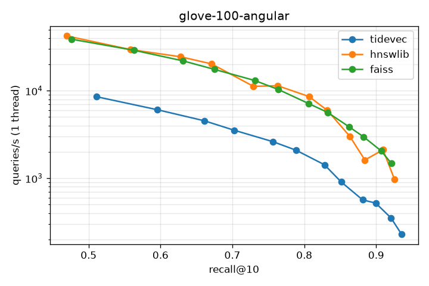
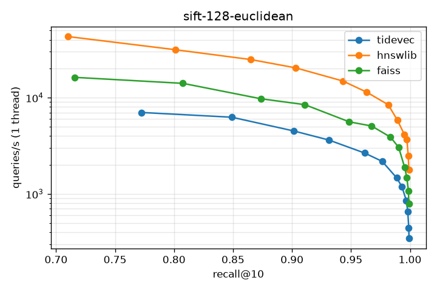

# ANN benchmark results

Generated by `report.py` from `results/*.json`. M=16, ef_construction=200, k=10, single-threaded build and search unless noted.

## glove-100-angular (n=1,183,514, d=100, 10,000 queries)

| Engine | Build, 1 thread (s) | Build, 16 threads (s) | Index RSS (MB) |
|---|---:|---:|---:|
| tidevec | 2497 | n/a (single-threaded insert) | 1183 |
| hnswlib | 375 | 48 | 726 |
| faiss | 331 | 46 | 629 |

Best single-thread QPS at a recall@10 target (p50 / p99 latency at that setting):

| Engine | recall ≥ 0.9 | recall ≥ 0.95 | recall ≥ 0.99 |
|---|---:|---:|---:|
| tidevec | 351 QPS (ef 384; 2.47 / 4.08 ms) | not reached | not reached |
| hnswlib | 2,111 QPS (ef 384; 0.48 / 0.72 ms) | not reached | not reached |
| faiss | 2,058 QPS (ef 384; 0.49 / 0.62 ms) | not reached | not reached |

Full ef_search sweep:

| Engine | ef | recall@10 | QPS (1 thread) | QPS (8 threads) | p50 ms | p99 ms |
|---|---:|---:|---:|---:|---:|---:|
| tidevec | 10 | 0.5111 | 8,540 | 57,659 | 0.129 | 0.279 |
| tidevec | 16 | 0.5957 | 6,064 | 46,053 | 0.161 | 0.357 |
| tidevec | 24 | 0.6609 | 4,535 | 33,775 | 0.220 | 0.477 |
| tidevec | 32 | 0.7026 | 3,535 | 25,393 | 0.299 | 0.613 |
| tidevec | 48 | 0.7566 | 2,614 | 20,387 | 0.370 | 0.732 |
| tidevec | 64 | 0.7887 | 2,088 | 15,730 | 0.484 | 0.950 |
| tidevec | 96 | 0.8281 | 1,425 | 10,862 | 0.706 | 1.306 |
| tidevec | 128 | 0.8513 | 908 | 7,211 | 1.105 | 1.819 |
| tidevec | 192 | 0.8812 | 566 | 5,758 | 1.363 | 2.237 |
| tidevec | 256 | 0.8994 | 519 | 4,705 | 1.671 | 2.744 |
| tidevec | 384 | 0.9208 | 351 | 3,165 | 2.474 | 4.076 |
| tidevec | 512 | 0.9353 | 229 | 2,365 | 3.317 | 5.346 |
| hnswlib | 10 | 0.4693 | 42,334 | 160,491 | 0.022 | 0.041 |
| hnswlib | 16 | 0.5583 | 29,545 | 128,278 | 0.032 | 0.061 |
| hnswlib | 24 | 0.6281 | 24,433 | 98,572 | 0.039 | 0.070 |
| hnswlib | 32 | 0.6711 | 20,253 | 73,815 | 0.047 | 0.083 |
| hnswlib | 48 | 0.7294 | 11,215 | 58,723 | 0.076 | 0.206 |
| hnswlib | 64 | 0.7630 | 11,407 | 51,192 | 0.084 | 0.184 |
| hnswlib | 96 | 0.8066 | 8,584 | 36,172 | 0.115 | 0.179 |
| hnswlib | 128 | 0.8320 | 5,969 | 22,370 | 0.163 | 0.296 |
| hnswlib | 192 | 0.8633 | 3,021 | 16,645 | 0.297 | 0.631 |
| hnswlib | 256 | 0.8843 | 1,616 | 13,104 | 0.626 | 0.851 |
| hnswlib | 384 | 0.9095 | 2,111 | 9,036 | 0.479 | 0.717 |
| hnswlib | 512 | 0.9256 | 968 | 7,390 | 1.082 | 1.454 |
| faiss | 10 | 0.4759 | 38,849 | 197,552 | 0.024 | 0.045 |
| faiss | 16 | 0.5632 | 29,000 | 166,268 | 0.033 | 0.060 |
| faiss | 24 | 0.6311 | 21,965 | 121,438 | 0.043 | 0.079 |
| faiss | 32 | 0.6751 | 17,541 | 88,434 | 0.054 | 0.097 |
| faiss | 48 | 0.7311 | 13,095 | 70,891 | 0.073 | 0.130 |
| faiss | 64 | 0.7641 | 10,317 | 51,365 | 0.093 | 0.178 |
| faiss | 96 | 0.8063 | 7,125 | 33,945 | 0.135 | 0.265 |
| faiss | 128 | 0.8323 | 5,664 | 28,586 | 0.175 | 0.267 |
| faiss | 192 | 0.8627 | 3,851 | 20,642 | 0.253 | 0.510 |
| faiss | 256 | 0.8825 | 2,976 | 15,844 | 0.337 | 0.474 |
| faiss | 384 | 0.9068 | 2,058 | 10,705 | 0.492 | 0.617 |
| faiss | 512 | 0.9213 | 1,477 | 7,395 | 0.676 | 1.047 |

## sift-128-euclidean (n=1,000,000, d=128, 10,000 queries)

| Engine | Build, 1 thread (s) | Build, 16 threads (s) | Index RSS (MB) |
|---|---:|---:|---:|
| tidevec | 1767 | n/a (single-threaded insert) | 1073 |
| hnswlib | 231 | 56 | 723 |
| faiss | 547 | 164 | 636 |

Best single-thread QPS at a recall@10 target (p50 / p99 latency at that setting):

| Engine | recall ≥ 0.9 | recall ≥ 0.95 | recall ≥ 0.99 |
|---|---:|---:|---:|
| tidevec | 4,512 QPS (ef 24; 0.24 / 0.40 ms) | 2,656 QPS (ef 48; 0.41 / 0.60 ms) | 1,185 QPS (ef 128; 0.83 / 1.24 ms) |
| hnswlib | 20,387 QPS (ef 32; 0.05 / 0.09 ms) | 11,401 QPS (ef 64; 0.09 / 0.19 ms) | 4,149 QPS (ef 192; 0.23 / 0.49 ms) |
| faiss | 8,461 QPS (ef 32; 0.09 / 0.40 ms) | 5,074 QPS (ef 64; 0.15 / 0.67 ms) | 3,046 QPS (ef 128; 0.24 / 3.17 ms) |

Full ef_search sweep:

| Engine | ef | recall@10 | QPS (1 thread) | QPS (8 threads) | p50 ms | p99 ms |
|---|---:|---:|---:|---:|---:|---:|
| tidevec | 10 | 0.7723 | 7,015 | 68,898 | 0.111 | 0.211 |
| tidevec | 16 | 0.8490 | 6,262 | 43,153 | 0.173 | 0.329 |
| tidevec | 24 | 0.9013 | 4,512 | 33,730 | 0.237 | 0.396 |
| tidevec | 32 | 0.9312 | 3,629 | 28,931 | 0.278 | 0.432 |
| tidevec | 48 | 0.9616 | 2,656 | 19,876 | 0.414 | 0.598 |
| tidevec | 64 | 0.9765 | 2,176 | 16,710 | 0.483 | 0.686 |
| tidevec | 96 | 0.9887 | 1,467 | 12,164 | 0.654 | 0.983 |
| tidevec | 128 | 0.9932 | 1,185 | 9,522 | 0.830 | 1.242 |
| tidevec | 192 | 0.9969 | 850 | 6,929 | 1.142 | 1.723 |
| tidevec | 256 | 0.9981 | 659 | 5,368 | 1.490 | 2.256 |
| tidevec | 384 | 0.9990 | 445 | 4,010 | 1.970 | 3.162 |
| tidevec | 512 | 0.9992 | 345 | 3,111 | 2.539 | 4.155 |
| hnswlib | 10 | 0.7099 | 43,179 | 197,069 | 0.023 | 0.036 |
| hnswlib | 16 | 0.8013 | 31,475 | 141,578 | 0.031 | 0.054 |
| hnswlib | 24 | 0.8651 | 24,878 | 125,380 | 0.039 | 0.083 |
| hnswlib | 32 | 0.9032 | 20,387 | 93,283 | 0.048 | 0.089 |
| hnswlib | 48 | 0.9431 | 14,895 | 69,977 | 0.068 | 0.101 |
| hnswlib | 64 | 0.9633 | 11,401 | 54,907 | 0.086 | 0.187 |
| hnswlib | 96 | 0.9815 | 8,450 | 37,086 | 0.121 | 0.168 |
| hnswlib | 128 | 0.9893 | 5,833 | 31,817 | 0.166 | 0.334 |
| hnswlib | 192 | 0.9952 | 4,149 | 21,833 | 0.233 | 0.489 |
| hnswlib | 256 | 0.9974 | 3,703 | 17,258 | 0.280 | 0.351 |
| hnswlib | 384 | 0.9985 | 2,497 | 11,039 | 0.410 | 0.622 |
| hnswlib | 512 | 0.9991 | 1,771 | 9,889 | 0.533 | 1.356 |
| faiss | 10 | 0.7157 | 16,257 | 95,653 | 0.044 | 0.219 |
| faiss | 16 | 0.8075 | 14,080 | 41,534 | 0.056 | 0.243 |
| faiss | 24 | 0.8735 | 9,746 | 40,755 | 0.075 | 0.354 |
| faiss | 32 | 0.9108 | 8,461 | 32,494 | 0.091 | 0.397 |
| faiss | 48 | 0.9485 | 5,607 | 20,583 | 0.124 | 1.066 |
| faiss | 64 | 0.9675 | 5,074 | 20,335 | 0.155 | 0.667 |
| faiss | 96 | 0.9835 | 3,891 | 14,267 | 0.208 | 0.877 |
| faiss | 128 | 0.9904 | 3,046 | 5,410 | 0.240 | 3.174 |
| faiss | 192 | 0.9954 | 1,892 | 5,226 | 0.343 | 5.427 |
| faiss | 256 | 0.9973 | 1,483 | 5,000 | 0.517 | 3.007 |
| faiss | 384 | 0.9987 | 1,070 | 3,381 | 0.759 | 3.048 |
| faiss | 512 | 0.9990 | 791 | 2,945 | 1.023 | 4.565 |

